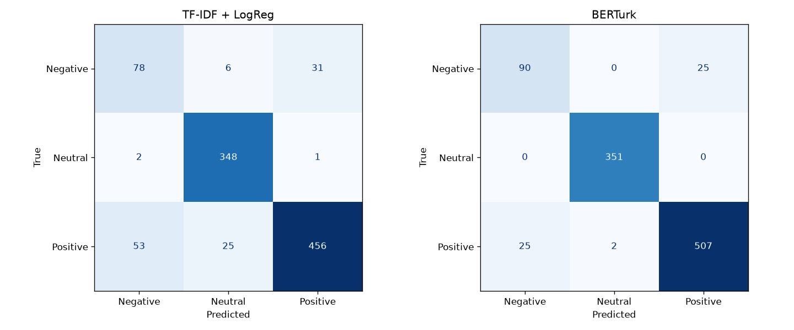

# Turkish Sentiment Analysis: TF-IDF vs. BERTurk

This project classifies Turkish texts as **Negative / Neutral / Positive** and compares two models:

1. **Baseline:** TF-IDF (word and character n-grams) + Logistic Regression
2. **BERTurk:** fine-tuned [`dbmdz/bert-base-turkish-cased`](https://huggingface.co/dbmdz/bert-base-turkish-cased)

**Dataset:** [`winvoker/turkish-sentiment-analysis-dataset`](https://huggingface.co/datasets/winvoker/turkish-sentiment-analysis-dataset), about 440k Turkish examples from product reviews, movie reviews, tweets and Wikipedia sentences.

**Stack:** Python, PyTorch, Hugging Face `transformers` & `datasets`, scikit-learn, Gradio

## Results

Both models were trained without a GPU (Intel i7-8650U, 4 cores), on a small stratified subset: **4,000 train / 500 validation / 1,000 test**. Stratified means each split keeps the original class proportions. Both models are evaluated on the **same test set**.

| Model | Accuracy | Macro F1 | F1 (Neg+Pos) | Training time |
|:--|--:|--:|--:|--:|
| TF-IDF + LogReg | 0.882 | 0.825 | 0.761 | 7 s |
| **BERTurk (2 epochs)** | **0.948** | **0.910** | **0.867** | 30 min (CPU) |

- **Macro F1** is the unweighted mean of the per-class F1 scores. The data is imbalanced (Negative is only 11.5%), so macro F1 is a fairer metric than accuracy.
- **F1 (Neg+Pos)** covers only the two real sentiment classes. The section on [shortcut learning](#key-finding-shortcut-learning) explains why the Neutral class is reported separately.

Per-class F1:

| Class | TF-IDF + LogReg | BERTurk |
|:--|--:|--:|
| Negative | 0.629 | **0.783** |
| Neutral | 0.953 | **0.997** |
| Positive | 0.892 | **0.951** |



Accuracy by text source:

| Source | TF-IDF | BERTurk |
|:--|--:|--:|
| Product reviews (`urun_yorumlari`) | 0.886 | 0.949 |
| Movie reviews (`HUMIR`) | 0.741 | 0.886 |
| Store reviews (`magaza_yorumlari`) | 0.545 | 0.773 |
| Tweets (`tweet-pn`) | 0.292 | 0.667 |
| Wikipedia (`wiki`) | 0.992 | 1.000 |

**Takeaway:** BERTurk helps most on the **Negative class** (F1 +0.15) and on **tweets** (+37 points). In these texts, context, negation and informal language matter. TF-IDF treats words independently, so it misses negated phrases such as *"I can't say the quality is top-notch"*. On the test set, BERTurk is right where the baseline is wrong in 77 cases. The reverse happens in only 11.

## Key finding: shortcut learning

The exploratory data analysis (EDA) showed that **100% of the Neutral examples come from Wikipedia sentences**, plus a few lorem ipsum filler texts. No product review or tweet is labeled Neutral.

As a result, the models learn to answer *"is this an encyclopedia sentence?"* instead of *"is this text neutral in sentiment?"*:

- The baseline's strongest Neutral features are `" ."` (the Wikipedia text has a space before each period) and encyclopedic suffixes and words such as `-dır`, `-dir`, `tarafından` ("by") and `vardır` ("there is").
- In the demo, BERTurk labels **"İki gün sonra bozuldu, param çöpe gitti."** (*"It broke after two days, my money went down the drain."*) as **Neutral with 98% confidence**. The sentence is clearly negative. But it is short, starts with a capital letter and ends with a period, while most user reviews in the training data are written in lowercase.

So the near-perfect Neutral score is misleading. This test set cannot measure how the models would handle a genuinely neutral review such as *"the product arrived yesterday."* That is why the results table also reports **F1 (Neg+Pos)**.

## Error analysis

BERTurk makes 52 errors on the 1,000 test examples. I manually inspected the **20 errors where the model was most confident**. All 20, each with a category and a note on the likely cause, are in [reports/error_analysis.csv](reports/error_analysis.csv) and [notebooks/02_results.ipynb](notebooks/02_results.ipynb).

| Category | Count | Example (translated) |
|:--|--:|:--|
| Mixed sentiment | 9 | *"I get small freezes sometimes, but it's a good product"*: labeled Negative, predicted Positive |
| Questionable label | 6 | *"...not nice at all"* labeled Positive. *"one of the best animations I've seen, but I gave it 2 points"*: the label comes from the rating, not the text |
| Indirect statement / comparison | 3 | *"The other headphones I bought have better sound. Don't be fooled."*: the positive words describe a different product |
| Negation / very short text | 1 | *"düşük kaliteli"* (*"low quality"*): the word "quality" dominates, and a two-word text gives no context |
| Source shortcut | 1 | *"Adjustable speed levels from the 1st button."*: a Wikipedia-style sentence, predicted Neutral |

**What the errors show:**

1. **Almost half of the errors are mixed-sentiment reviews.** The labels most likely come from star ratings, so the "correct" label for a review like *"shipping was great but the product is bad"* is debatable. Three classes are not enough for such texts. Aspect-based sentiment analysis (separate scores for shipping, product and price) would fit them better.
2. **6 of the 20 labels are questionable.** The model's real error rate is therefore somewhat lower than reported. Noisy labels also cap the best score any model can reach.
3. **The model over-weights positive phrases at the start of a text.** It fails on reviews that open with praise and put the real complaint at the end.
4. **Irony is not handled.** Both models label *"Harika, yine kargom kayboldu. Tebrikler!"* (*"Great, my package got lost again. Congrats!"*) as Positive.

## Demo

```powershell
.\.venv\Scripts\python.exe app.py
```

Then open http://127.0.0.1:7860. The Gradio app shows both models' class probabilities side by side for any text you enter.

Results on the built-in examples:

| Text (English translation) | TF-IDF + LogReg | BERTurk |
|:--|:--|:--|
| Ürün çok kaliteli, kargo da hızlıydı. Herkese tavsiye ederim. *(Great quality, fast shipping. I recommend it to everyone.)* | Positive (0.99) | Positive (1.00) ✅ |
| Hiç fena değil, fiyatına göre gayet iyi. *(Not bad at all, quite good for the price.)* | Positive (0.65) | Positive (0.99) ✅ |
| İki gün sonra bozuldu, param çöpe gitti. *(It broke after two days, my money went down the drain.)* | Negative (0.42) ✅ | **Neutral (0.98)** ❌ shortcut |
| Kargo berbattı ama ürün beklediğimden güzel çıktı. *(Shipping was terrible but the product was better than expected.)* | Positive (0.56) | Positive (0.85) ~ mixed |
| Harika, yine kargom kayboldu. Tebrikler! *(Great, my package got lost again. Congrats!)* | Positive (0.67) ❌ | Positive (1.00) ❌ irony |
| İstanbul, Türkiye'nin en kalabalık şehridir. *(Istanbul is Turkey's most populous city.)* | Neutral (0.75) ✅ | Neutral (1.00) ✅ |

## Project structure

```
turkish-sentiment-analysis/
├── data/                 # train/val/test.csv subsets + raw_*.parquet (full data, git-ignored)
├── notebooks/
│   ├── 01_eda.ipynb      # Exploratory data analysis
│   ├── 02_results.ipynb  # Model comparison + error analysis
│   └── _build_*.py       # Scripts that generate the notebooks
├── src/
│   ├── config.py         # Paths, labels, subset sizes
│   ├── data.py           # Download, cleaning, stratified subsets
│   ├── baseline.py       # TF-IDF + LogReg (C selected on the validation set)
│   ├── train_bert.py     # BERTurk fine-tuning
│   ├── evaluate.py       # Metrics, confusion matrices, misclassified examples
│   └── error_comments.py # Hand-written notes on the 20 errors
├── reports/              # Metrics, predictions, figures
├── models/               # Trained models (git-ignored)
├── app.py                # Gradio demo
└── requirements.txt
```

## Setup

```powershell
python -m venv .venv
```
```powershell
.\.venv\Scripts\python.exe -m pip install torch --index-url https://download.pytorch.org/whl/cpu
```
```powershell
.\.venv\Scripts\python.exe -m pip install -r requirements.txt
```

## Reproducing the results

Run the steps in this order:

```powershell
.\.venv\Scripts\python.exe -m src.data          # download data + build subsets
```
```powershell
.\.venv\Scripts\python.exe -m src.baseline      # ~1 min
```
```powershell
.\.venv\Scripts\python.exe -m src.train_bert    # ~30-70 min on CPU, a few minutes on a GPU
```
```powershell
.\.venv\Scripts\python.exe -m src.evaluate      # results table + confusion matrices + misclassified examples
```

**With a GPU**, use a larger subset: `python -m src.data --n-train 40000 --n-val 4000 --n-test 5000`. `train_bert.py` detects the GPU automatically and uses fp16. Retraining changes which examples are misclassified, so the notes in `src/error_comments.py` would need updating.

## Lessons learned

- **Start with a baseline.** A 7-second model reached 93% of the accuracy of a 30-minute BERT model. The value of BERT only becomes clear through this comparison.
- **Look at the data.** The Neutral-class shortcut only showed up when I inspected the `dataset` (source) column. None of the metrics alone would have revealed it.
- **Verify library behavior.** My first BERT run scored 0.44 accuracy on the test set while validation accuracy was 0.95, which is impossible for a working model. The cause: in transformers 5, the `group_by_length` sampler also reorders examples during `trainer.predict()`, so predictions were matched to the wrong rows. The fix is a simple, order-preserving inference loop (`predict_proba` in `src/train_bert.py`).

## Possible improvements

- Add genuinely neutral reviews to the Neutral class, or reframe the task as binary **Positive/Negative** classification.
- Reduce label noise by manually checking examples where the model confidently disagrees with the label (*confident learning*).
- Train on more data for more epochs (with a GPU). Use a class-weighted loss to improve Negative recall.
- Compare speed and accuracy with a smaller model such as DistilBERTurk.
